<div align="center">



# Agent Session Pilot

### Your coding agents: awake, watched, and one message away
**Sleep prevention, Telegram remote control, RAM and disk watch, and local voice dictation. macOS, Windows, and Linux servers.**

<sub>Formerly Agents Sleep Preventer. Same app, same updates, same `asp` command.</sub>

<br>

[](https://github.com/CharlonTank/agents-sleep-preventer/releases/latest/download/AgentsSleepPreventer-5.6.0.dmg)

<br>


[](https://opensource.org/licenses/MIT)
[](https://github.com/CharlonTank/agents-sleep-preventer/releases)

</div>

---

## The Problem

You ask your coding agent to refactor your codebase. It's going to take 10 minutes. You close your MacBook lid to grab coffee...

**💀 Mac sleeps. The agent stops. Work lost.**

## The Solution

Install this tool. Your computer stays awake while your agent works; normal sleep resumes when it finishes. On macOS, it can also keep working with the lid closed and provides local speech-to-text dictation. Windows prevents automatic idle sleep and respects the configured lid and power-button actions.

<div align="center">

| Before (macOS) | After (macOS) |
|--------|-------|
| 😴 Lid closed = Mac sleeps | ☕ Lid closed = agent keeps working |
| 🔄 Come back to interrupted work | ✅ Come back to finished work |

</div>

---

## Features

- Sleep prevention while supported coding agents are active, on macOS and Windows
- A macOS menu bar app or Windows tray app, with automatic and manual sleep controls
- Auto-resume on macOS: when a network drop cuts Claude Code or Codex off, it types "continue" into the agent's terminal once the connection is back
- Safety nets on macOS: a nightly sleep time, and sleep at low battery (10% by default), even with agents still working
- Telegram on macOS: talk to every Claude Code session from your phone through your own bot (`asp telegram setup`, then `/telegram` in a session), voice notes transcribed locally
- RAM and disk watch on macOS: names the session behind a memory or disk drift, by notification and on Telegram
- Workshop on macOS: `asp workshop` opens your named Claude Code sessions in iTerm in one go

- Local voice dictation with a customizable hotkey: hold Fn+Shift on macOS, toggle Ctrl+Alt+Space on Windows
- Two dictation engines: Whisper (best accuracy, custom vocabulary) or Parakeet v3 (near-instant transcription)
- English transcription by default, with language selection in Settings
- Dictation settings, recording cues, and local transcription history
- macOS extras: agent notifications, terminal controls, and signed Sparkle updates

---

## Installation

### Linux server (Telegram, RAM and disk watch, workshop)

For a machine that never turns off, without a desktop:

```bash
curl -fsSL https://asp.charlon.dev/install.sh | sh
asp telegram setup
```

It installs `asp` in `~/.local/bin`, plus a systemd user service (`asp serve`) that watches RAM and disk and alerts you on Telegram. Your Claude Code sessions run in tmux: `asp workshop` opens them (`[workshop]` in `~/.local/share/AgentsSleepPreventer/config.toml`), and `/telegram` in each lets you drive them from your phone. Voice notes need ffmpeg (`sudo apt install ffmpeg`); setup offers the transcription model. Linux has no menu bar, dictation or sleep prevention.

### Windows 10 / 11

[Download the Windows ZIP](https://github.com/CharlonTank/agents-sleep-preventer/releases/latest/download/AgentsSleepPreventer-5.6.0-windows-x86_64.zip), extract it, and run `asp.exe` for the system tray app. To install native Claude Code/Codex hooks and start at login, run this in PowerShell from the extracted folder:

```powershell
.\asp.exe install --yes
```

No administrator rights are required. See the [Windows guide](windows/README.md) for build prerequisites, commands, verification, and platform differences. For dictation, open **Dictation Settings…** in the tray menu, choose Whisper or Parakeet, then **Download Dictation Model…**. Press Ctrl+Alt+Space to start recording and again to insert the transcript.

Requires macOS 14 Sonoma or later on Apple Silicon.

### 🍎 Download DMG (Easiest)

1. [Download the latest DMG](https://github.com/CharlonTank/agents-sleep-preventer/releases/latest/download/AgentsSleepPreventer-5.6.0.dmg)
2. Drag `AgentsSleepPreventer.app` to Applications
3. Launch the app - it will auto-configure on first run
4. Restart your coding agents

The menu bar app uses Sparkle for in-app updates and can download + install new signed releases directly.

### 🍺 Homebrew

```bash
brew install --cask charlontank/tap/agents-sleep-preventer
```

Then launch Agent Session Pilot from Applications: it sets up the agent hooks on first run.

### 🦀 Build from Source

```bash
git clone https://github.com/CharlonTank/agents-sleep-preventer.git
cd agents-sleep-preventer
cargo build --release
./target/release/asp install
```

---

## How It Works

### Sleep Prevention

```
You send a prompt
       ↓
   Agent starts working → 🔒 Sleep disabled
       ↓
   Agent finishes → 🔓 Sleep re-enabled
```

Sleep prevention works automatically after setup.

### Nightly Sleep and Low Battery (macOS)

Two safety nets, set from the menu's **…** button, put the Mac to sleep even while agents are still working:

- **Nightly Sleep** (off by default): every night from the time you choose, the Mac goes to sleep the first time nobody is using it (no input for a minute and no video playing), even when forced awake. Agents can't keep it awake again until you come back. `asp bedtime 2:00`, `asp bedtime off`.
- **Sleep on Low Battery** (10% by default): on battery at or below that charge, agents no longer keep the Mac awake, and it goes to sleep as soon as nobody is using it instead of draining to zero. `asp low-battery 15`, `asp low-battery off`.

### Auto-Resume After Network Drops (macOS)

On a train or a flaky Wi-Fi, an agent's turn can end on a network error and the work stalls until you type "continue". Agent Session Pilot does it for you:

1. Claude Code reports the failure through its `StopFailure` hook; Codex records it in its session log.
2. The menu shows the agent as cut off, and the Mac stays awake for up to 30 minutes.
3. Once the API has answered for 20 seconds in a row (a captive portal doesn't count), it types a "continue" prompt into that agent's terminal: iTerm2, Terminal or tmux. API errors such as "overloaded" are retried after a pause instead.

It gives up after 3 tries in a row, never touches usage-limit, login or billing errors, and waits if you are typing in that very terminal. Turn it off from the menu's **…** button or with `asp auto-resume off`.

### Dictation

Agent Session Pilot includes local speech-to-text dictation:

1. Open the app and allow Microphone and Accessibility permissions.
2. Download the local Whisper model when prompted.
3. Press and hold Fn+Shift (default) to record, then release to transcribe and insert text.

Dictation starts in English by default. To change the language, the hotkey, or the engine, open `Settings...` and select the `Dictation` tab.

Two engines are available:

| Model | Best for |
|---|---|
| **Whisper Turbo** (574 MB / 1.6 GB) | Best accuracy, 99 languages, custom vocabulary support |
| **Parakeet v3** (670 MB) | Near-instant transcription, English + 24 European languages |

---

## Commands

```bash
asp status     # Check current state
asp settings   # Open sleep prevention and dictation settings
asp cleanup    # Clean up after interrupts
asp auto-resume on|off  # Type "continue" after a network drop (macOS)
asp bedtime 2:00|off    # Sleep every night from this time, agents or not (macOS)
asp low-battery 10|off  # Sleep on battery at or below this charge (macOS)
asp telegram setup      # Connect your own Telegram bot (macOS)
asp monitor status      # RAM of each Claude Code session, memory and disk (macOS)
asp workshop            # Open your named sessions in iTerm, from config.toml (macOS)
asp uninstall  # Remove completely
```

---

## Configuration (optional, macOS)

Everything works without a config file. To change the defaults, create `~/Library/Application Support/AgentsSleepPreventer/config.toml`:

```toml
[monitor]
session_gb = 8            # alert when a session's process tree passes this (critical: session_critical_gb = 16)
disk_free_gb = 30         # alert under this much free disk (critical: disk_free_critical_gb = 15)

[workshop]
projects_dir = "~/projects"
terminal = "tmux"         # or "iterm"; default: tmux over SSH or inside tmux, else iTerm

[[workshop.tab]]          # one tab; two panes side by side
panes = [{ dir = "my-app", session = "dev" }, { dir = "my-app", session = "review" }]
```

---

## FAQ

**Does it drain my battery?**
No more than usual. Your Mac just stays awake instead of sleeping. On battery at 10% or less (adjustable), agents no longer keep it awake and it goes to sleep once you step away.

**What if I interrupt an agent with Ctrl+C?**
Run `asp cleanup` or the tool auto-detects idle sessions after 30 seconds.

**Does it work with multiple agent instances?**
Yes! Mac stays awake until ALL instances finish.

**How do app updates work?**
The menu bar app uses Sparkle. Use `Check for Updates...` from the menu bar app, or let Sparkle check automatically in the background. New signed releases are installed through Sparkle instead of just opening a DMG download.

---

<div align="center">

Made with ☕ for coding agent users

[Report Issue](https://github.com/CharlonTank/agents-sleep-preventer/issues) · [View Releases](https://github.com/CharlonTank/agents-sleep-preventer/releases)

</div>
